<div align="center">

# ZeroFuann<sub>.</sub>

**Escucho el problema. Construyo la solución. La llevo a producción.**

Portafolio de **Jose Juan Juarez Martinez**, desarrollador full stack enfocado en productos con IA.

[**Ver el portafolio**](https://zerofuann.vercel.app) · [Servicios para clientes](https://zerofuann.vercel.app/servicios) · [LinkedIn](https://www.linkedin.com/in/josejuanjuarezmartinez)


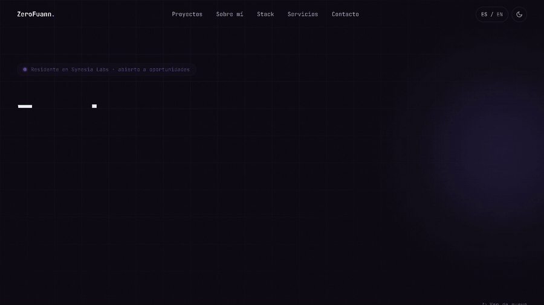

</div>

El inicio cuenta un caso real: una usuaria de [Brío](https://github.com/ZeroFuann-FS/brio) reporta que no puede registrar empanadas de queso, lo reviso, hago el commit y queda publicado el mismo día. Esa es la forma en que me gusta trabajar, cerca de quien usa el software.

## Qué tiene

- **Portafolio** (`/`) en español e inglés, con modo claro y oscuro: proyectos como casos de estudio (problema → solución), stack con niveles honestos, línea de tiempo, experiencia y certificaciones verificables.
- **Página para clientes** (`/servicios`): servicios, trabajos reales, proceso, preguntas frecuentes y cotización por WhatsApp o formulario.
- **Libro de visitas con estrellas:** cualquiera deja una reseña; solo se publican las que apruebo.
- **Panel privado** (`/admin`): aprobar reseñas y atender mensajes y cotizaciones, con inicio de sesión de Supabase.
- **Animaciones:** texto que aparece por palabras, secciones que se revelan al bajar, botones magnéticos, tarjetas con efecto 3D y desplazamiento suave. Respetan "reducir movimiento".

## Capturas

| Modo oscuro | Modo claro |
|---|---|
| 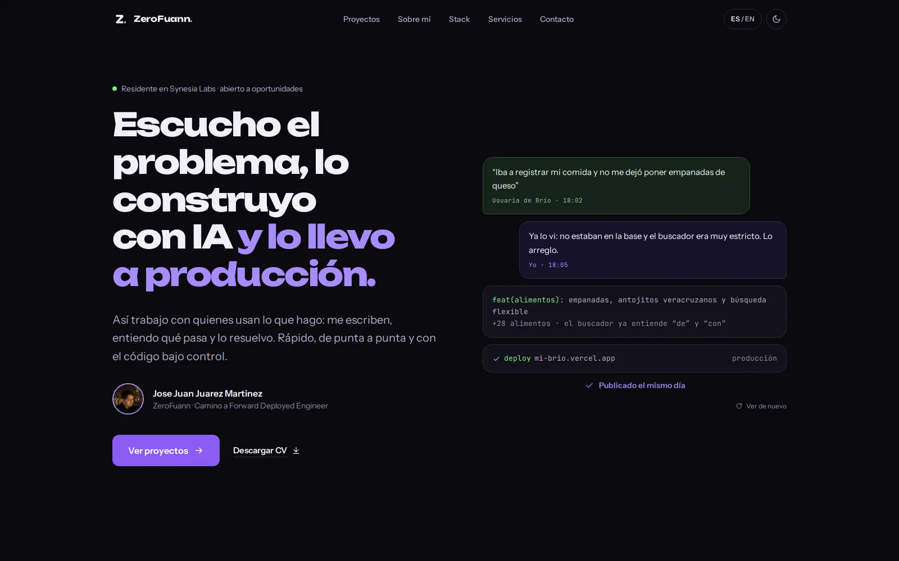 | 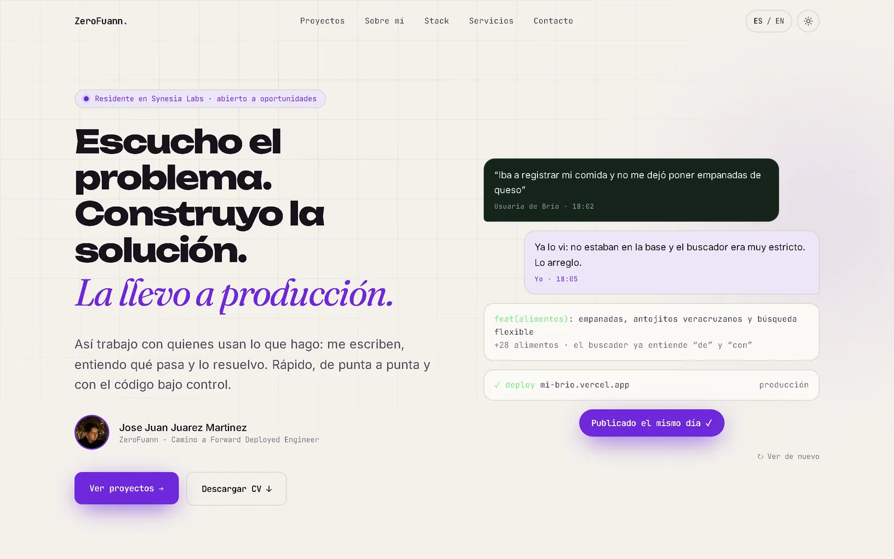 |

| Sobre mí | Mi camino |
|---|---|
| 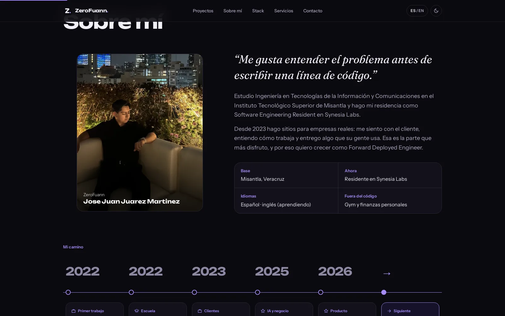 | 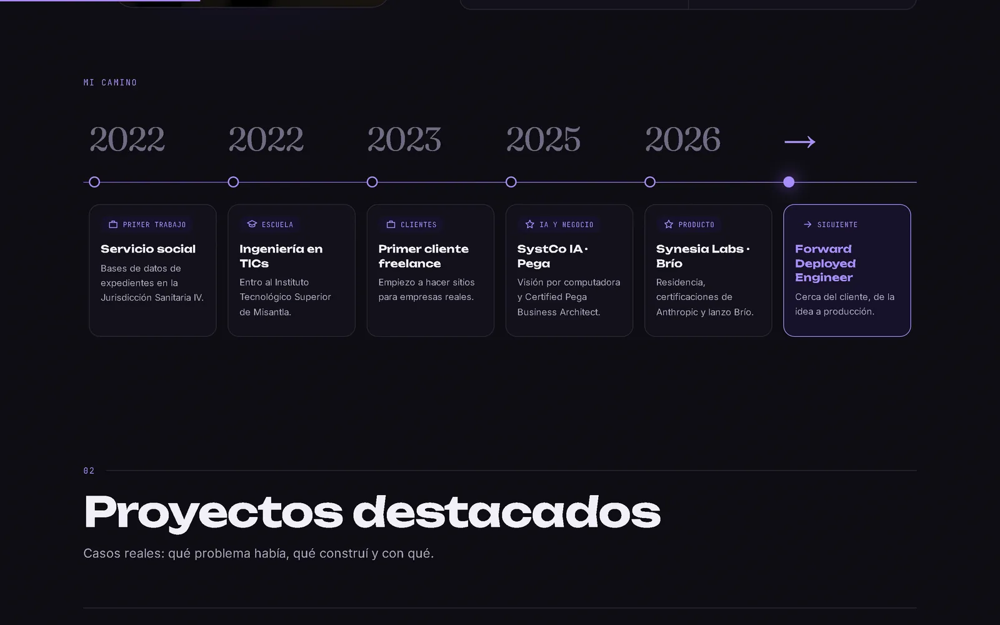 |

| Proyectos | Stack |
|---|---|
| 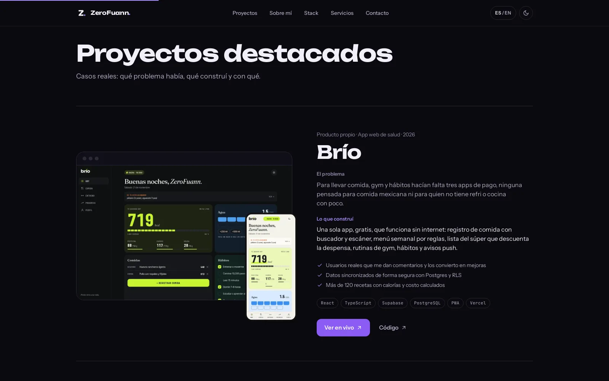 | 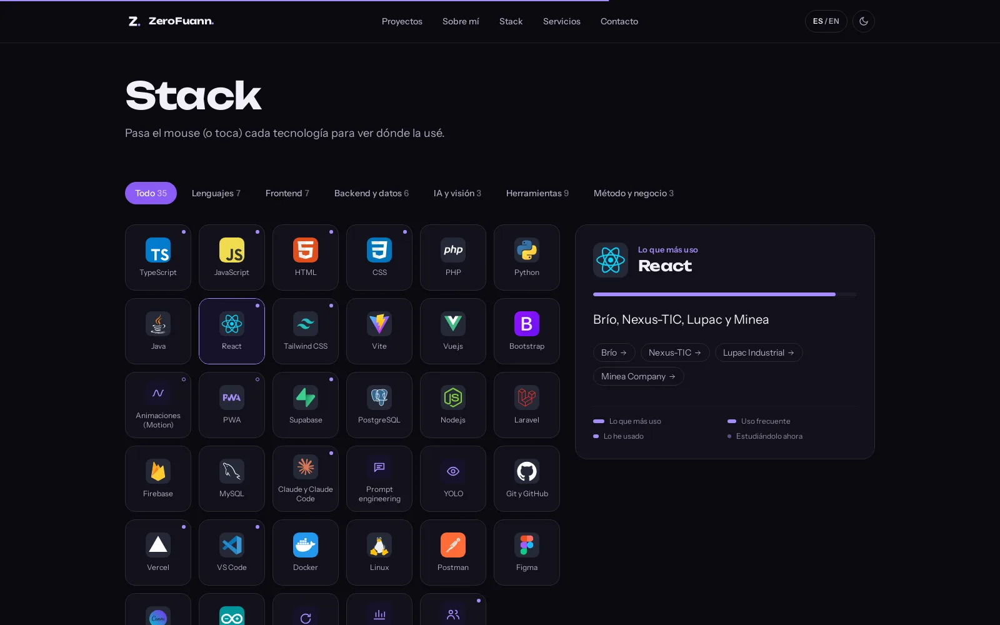 |

| Servicios | Contacto |
|---|---|
| 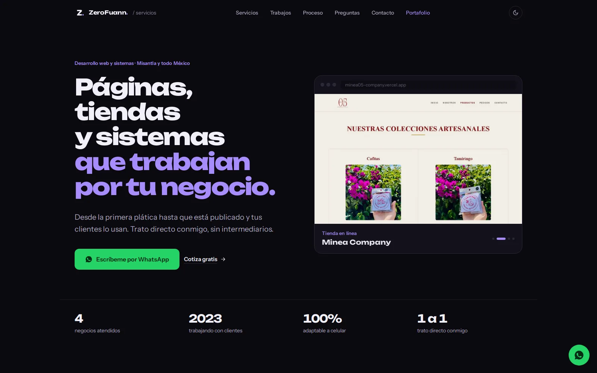 | 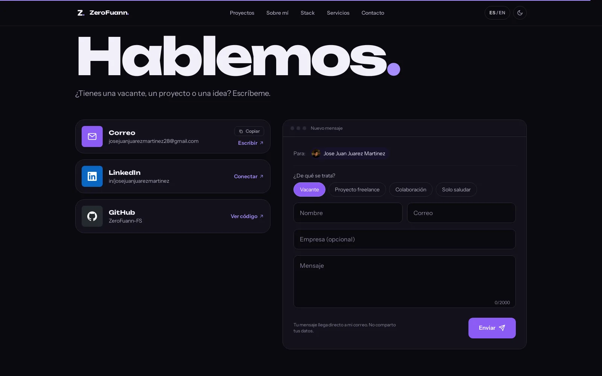 |

<p align="center">
  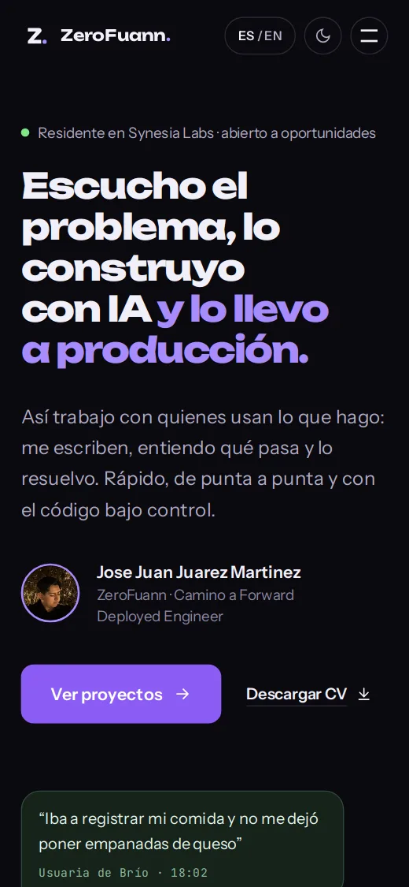
  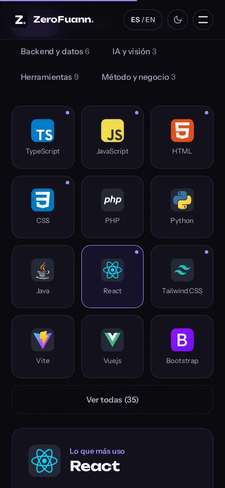
  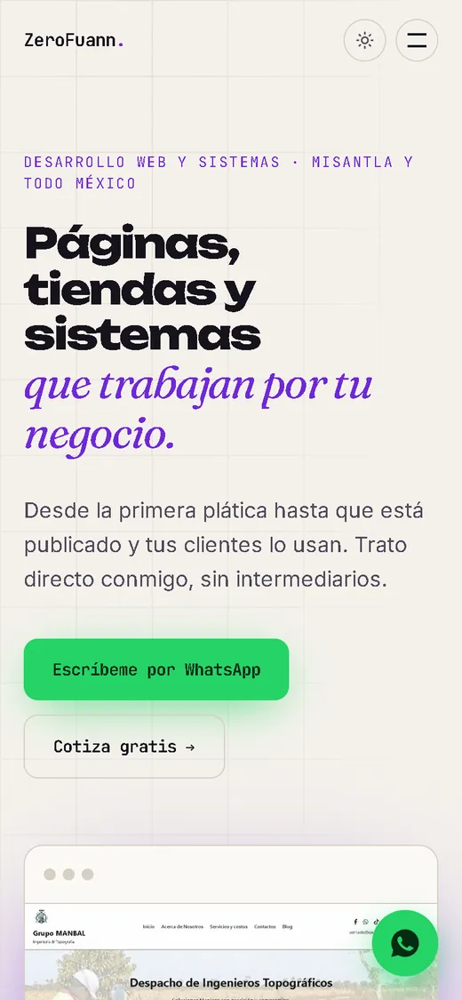
</p>

## Tecnología

**React 19 · TypeScript · Vite · Tailwind CSS 4 · Motion · Lenis · Supabase (Postgres + RLS, Auth) · Vercel**

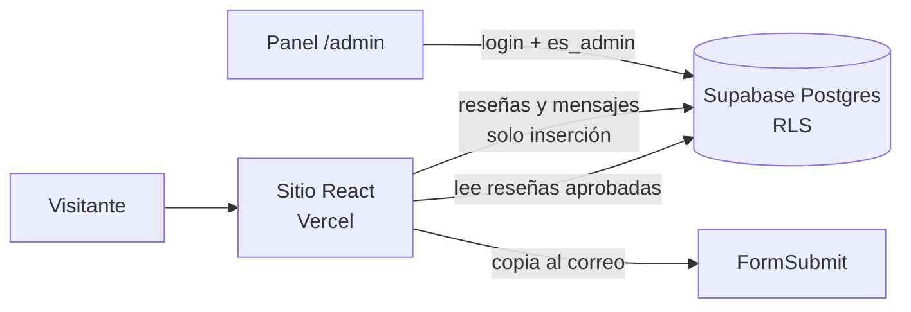

## Decisiones técnicas

- **Seguridad en la base de datos:** los visitantes solo pueden insertar (las reseñas llegan sin aprobar) y leer lo aprobado; aprobar, leer mensajes o borrar exige ser administrador, verificado en Postgres con RLS.
- **Ningún mensaje se pierde:** cada formulario se guarda en Supabase y además se envía por correo; basta con que uno de los dos funcione.
- **Datos personales fuera del repo:** el número de WhatsApp y las llaves viven en variables de entorno de Vercel; las fotos se publican recortadas y sin metadatos.
- **Contenido separado del código:** todos los textos (ES/EN), proyectos y stack están en [`src/data/contenido.ts`](src/data/contenido.ts).
- **Carga ligera:** el panel privado se descarga solo si alguien entra a `/admin`.

## Correr en local

```bash
npm install
cp .env.example .env.local   # llaves de Supabase y número de WhatsApp
npm run dev
```

## Licencia

© 2026 Jose Juan Juarez Martinez (ZeroFuann). Todos los derechos reservados: el código se publica solo para consulta. Ver [LICENSE](LICENSE).
